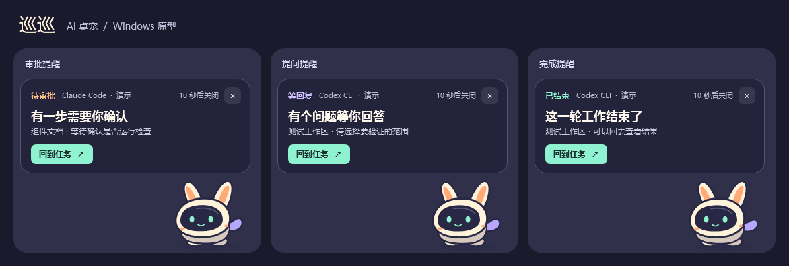

# 巡巡 XunXun

巡巡是一只 Windows 桌宠。它会在桌面散步、玩球、和鼠标互动，也会提醒你去处理 Claude Code、Codex CLI 和 T3 Code 的任务。想知道今天要不要带伞、关注的工具有没有更新，可以打开 **每日简报**。



[快速开始](#快速开始) · [任务提醒](#任务提醒) · [桌面互动](#桌面互动) · [每日简报](#每日简报) · [排查与自测](#排查与自测)

## 快速开始

巡巡是 Windows x64 的 .NET 9 WPF 单文件程序。运行前请安装 [.NET 9 桌面运行时](https://dotnet.microsoft.com/download/dotnet/9.0)。

- 已有 ZIP 时，先把 `XunXun.exe` 解压到常用目录，再双击运行。
- 从源码构建时，请在 Windows 上安装 .NET 9 SDK，再执行下面的命令。编译后打开 `release\XunXun.exe`。覆盖构建前，可以通过右键菜单的 **退出巡巡** 关闭正在使用的 EXE。

```powershell
git clone https://github.com/xiaoaf45/xunxun-desktop-pet.git
cd xunxun-desktop-pet
dotnet publish .\src\XunXun.csproj -c Release -r win-x64 --self-contained false -p:PublishSingleFile=true -p:DebugType=None -o .\release
```

右键巡巡或托盘图标，选择 **播放提醒演示**，即可体验审批、提问和完成气泡。点击 **回到任务** 会打开模拟任务窗口。也可以在启动时传入 `--demo`。

## 任务提醒

| 来源 | 结构化提问 | 待审批 | 完成 | 返回入口 |
| --- | --- | --- | --- | --- |
| Claude Code | `AskUserQuestion` 和 MCP 结构化提问 | 工具权限请求 | 本轮回复结束 | 已绑定的终端窗口 |
| Codex CLI | — | 工具权限请求 | 本轮回复结束 | 已绑定的终端窗口 |
| T3 Code | — | — | 主会话及后台工作结束 | 优先在桌面端打开对应会话 |

巡巡会继续漫游，提醒在原位置停留 10 秒。点 × 或成功跳回工作区后，当前气泡会立即收起。气泡消失后，可以在右键菜单的 **任务收件箱** 找回最近 100 条记录。待审批和待回答排在完成记录前面，对应工具处理完后会从待处理列表移除。用 **免打扰** 可以暂时隐藏气泡。

### 接入 Claude Code 和 Codex CLI

1. 安装对应的 CLI 后启动巡巡。它会检查已安装工具是否需要注册或迁移提醒 Hook。
2. 在窗口中勾选工具并点击 **注册所选 Hook**。稍后也可以从右键菜单的 **设置任务提醒** 打开注册界面。
3. 重开 CLI 会话。Codex 还需在 `/hooks` 中审查并信任巡巡的 Hook。

注册会合并巡巡自己的条目，每个事件保留一条巡巡 Hook。其他 Hook 会保留，修改前的文件会备份在原配置目录。Claude Code 的 Hook 使用明文 PowerShell 命令。两种 Hook 都通过当前 Windows 用户和会话的命名管道发送事件类型、会话标识、项目目录末级名称和窗口绑定信息。完成提醒对应 `Stop` 事件，即本轮回复结束。 [Claude Code Hooks](https://code.claude.com/docs/en/hooks) · [Codex Hooks](https://learn.chatgpt.com/docs/hooks)

### 从巡巡启动并绑定终端

双击巡巡，或右键选择 **启动 Claude / Codex**。选择工具和项目目录后，巡巡会打开独立的 PowerShell 窗口，并优先由 Windows Terminal 显示。最近 12 个项目目录可以从下拉列表重选。

Hook 接入后，点击 **切到任务窗口** 或收件箱里的 **回到工作区**，即可返回对应会话。CLI 退出时，巡巡启动的 PowerShell 随之退出，Windows Terminal 按其终端配置处理窗口。

**无需审批** 默认关闭，只在当次勾选时生效。Claude Code 使用 `--permission-mode bypassPermissions`，Codex CLI 使用 `--ask-for-approval never` 并沿用工具当前的沙箱权限。

### 接入 T3 Code

确保能运行 `t3` CLI。在 `XunXun.exe` 同目录建立 `t3-projects.json`，将下面的值换成实际项目 ID，再重启巡巡。

```json
[
  "00000000-0000-0000-0000-000000000001"
]
```

用 `t3 thread list --json --project <项目 ID>` 可以检查 CLI 是否能读取该项目。巡巡启动时先记录现有状态，之后只提醒新完成的主会话。**回到 T3 Code** 优先使用 `t3code://` 打开对应会话，Windows 找不到桌面协议或无法启动时会打开会话网页。

<details>
<summary>手动配置 Hook 和绑定终端</summary>

从仓库根目录生成配置样例，输出在 `adapters/examples/`，并引用指定 EXE 的绝对路径。

```powershell
.\adapters\New-HookExamples.ps1 -Executable .\release\XunXun.exe
```

- **Claude Code**。从目标终端运行 `.\adapters\Start-Harness.ps1 -Provider claude`，脚本会用 `--settings` 加载样例。样例需要支持 `shell: powershell` 的 Claude Code 版本。
- **Codex CLI**。将样例 `codex-hooks.json` 合并进受信任项目的 `.codex/hooks.json`，再从目标终端运行 `.\adapters\Start-Harness.ps1 -Provider codex`，在 `/hooks` 中审查并信任。

手动脚本记录的是窗口。多个 Windows Terminal 标签页共用同一窗口时，切回后需自行选中相应标签页。

</details>

## 桌面互动

- 巡巡会散步、小跳、拍球和踢球，也能在相邻屏幕漫游或追鼠标。遇到密集的桌面图标时会缩小穿过去。
- 单击摸头，来回滑动挠痒。长按拖动时它会扭身挣扎。悬停等它伸爪后单击可以击掌，光标会随爪子抬起，主动移动鼠标即可放开。
- 把鼠标移到巡巡身上，可以喂食、抛球、让它跳舞或小睡。

[动作预览](preview/xunxun-play.png)

### 喝水和起身提醒

从右键菜单打开 **喝水和起身提醒**。默认每 45 分钟提醒喝水、每 60 分钟提醒起身，可分别开关和调整。锁屏或连续 5 分钟没有键鼠操作时暂停计时，回来后继续。

到点时巡巡会抱起水杯或伸懒腰。可点 **完成**、**10 分钟后** 或 **今天跳过**。气泡 10 秒后自动收起，默认 10 分钟后再提醒一次。

## 每日简报

从右键菜单打开 **每日简报**，可以手动 **刷新**。在 **订阅设置** 里选城市、栏目、GitHub 主题和资讯关键词。**每天推送简报** 默认关闭，开启后的默认时间是 08:30。

| 栏目 | 内容 |
| --- | --- |
| 出门天气 | 所选城市的当地预报日期、温度范围和 07:00–10:00 最高降水概率。达到 50% 时，巡巡撑伞来提醒。 |
| 工具正式版 | Claude Code 和 Codex 的最新正式版。首次自动检查记录当前版本，后续发现新正式版才计入推送。 |
| GitHub 主题 Top 3 | 所选主题近 7 个 UTC 日新建的仓库，按累计星标排序，最多展示三个。 |
| 前沿 AI 资讯 | 从 OpenAI、Google DeepMind 和 Hugging Face 的公开订阅源筛选近 7 天的内容，最多展示 3 条，可点开原文。 |
| 今日任务小结 | 可单独开启，默认 18:00。在本机统计收件箱当天保留的完成记录、当前待审批和待回答数量，可打开收件箱。 |

巡巡会叼份报纸来送简报。在巡巡运行期间，简报和任务小结各自每天最多弹一次。锁屏、空闲或有任务提醒时顺延，只补发当天。完整预报超时或服务出错时尝试查询日预报，并标记上午降水概率暂缺。其他来源失败时显示可用缓存及更新时间。 [数据入口与测试记录](docs/briefing-plan.md)

## 排查与自测

### 常见情况

| 情况 | 检查方法 |
| --- | --- |
| Claude Code 没有提醒 | 检查桌宠与 CLI 是否在同一 Windows 用户和会话下运行，核对配置目录，重开 CLI。 |
| Codex 没有提醒 | 在 `/hooks` 中确认巡巡条目已受信任，再重开会话。 |
| 有提醒但显示未绑定窗口 | 通过 **启动 Claude / Codex** 或手动脚本打开新的终端会话。 |
| T3 Code 没有提醒 | 检查 `t3-projects.json` 是否与 EXE 同目录，并用 CLI 验证项目 ID。 |
| 简报缺少天气或其他栏目 | 在 **订阅设置** 确认城市和栏目，再点 **刷新**，可在简报里查看失败状态和缓存时间。 |
| 旧 Hook 指向压缩包临时目录 | 把新版 EXE 解压到固定目录，再从 **设置任务提醒** 完成一次迁移。 |

### 本机文件

| 内容 | 默认位置 |
| --- | --- |
| Claude Code 用户配置 | `%USERPROFILE%\.claude\settings.json`，可由 `CLAUDE_CONFIG_DIR` 指定目录 |
| Codex CLI 用户 Hook | `%USERPROFILE%\.codex\hooks.json`，可由 `CODEX_HOME` 指定目录 |
| 巡巡的 Hook 接收程序 | `%LOCALAPPDATA%\XunXun\HookRelay\XunXun.exe` |
| 巡巡的项目历史、收件箱、生活提醒和订阅 | `%LOCALAPPDATA%\XunXun` |
| T3 Code 项目清单 | 与 `XunXun.exe` 同目录的 `t3-projects.json` |

### 构建自测

源码位于 [src/](src)，手动接入脚本位于 [adapters/](adapters)，动作和提醒预览位于 [preview/](preview)。

```powershell
$testDir = Join-Path (Get-Location).Path 'src\obj\xunxun-self-test'
$result = Start-Process -FilePath .\release\XunXun.exe -ArgumentList @(
    '--self-test', ('"{0}"' -f $testDir)
) -Wait -PassThru
Get-Content -LiteralPath (Join-Path $testDir 'self-test.txt') -Encoding UTF8
if ($result.ExitCode -ne 0) { throw '巡巡自测失败。' }
```

自测覆盖 Hook 注册和事件转发、T3 完成与链接、收件箱、生活提醒、简报解析和调度、桌面图标避让及跨屏路线。双屏和 Windows 前台切换的实机检查状态会写在报告里。

## 许可证

本项目采用 [MIT 许可证](LICENSE)。
